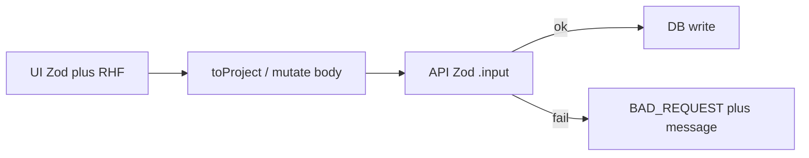

# API validators as a second layer

The UI already validates with Zod + RHF. The API has Zod `.input()` on most mutations, but it is looser than the forms (empty `clientId`, optional phone/company, unbounded amounts, untyped comments, unformatted repo). Frontend schemas stay as they are. The API gets the same **semantic** rules on the **payload** shape it already receives (after `toProject()` / contact create), with English messages matching [apps/web/src/i18n/en-US.json](apps/web/src/i18n/en-US.json) `validation.*`.

Do **not** share form schemas. Form values are strings/locale/`isNewContact`; API payloads are numbers/`clientId`. Duplicate the rules on purpose.

## Gaps to close

### Contacts — [apps/api/src/routers/contacts.ts](apps/api/src/routers/contacts.ts)

Today: `phone` / `company` optional; `id` any string.

Match [create-contact-dialog.tsx](apps/web/src/components/settings/create-contact-dialog.tsx):

- `name`: trim, min 2 — `"Enter at least 2 characters"`
- `email`: optional / `""`; if set, email — `"Invalid email"`
- `phone`: trim, min 1 — `"Enter the phone number"`
- `company`: trim, min 1 — `"Enter the company"`
- `id` on update/delete: trim, min 1

`contacts.list` stays with no input (no args).

### Custom tools — [apps/api/src/routers/tools.ts](apps/api/src/routers/tools.ts)

Already close. Tighten `category` to `toolCategorySchema` (`z.enum` of the slugs in [packages/shared/src/tool-category.ts](packages/shared/src/tool-category.ts)) with `"Select a category"`. Add that enum to shared next to the existing type.

### Projects — [apps/api/src/routers/projects.ts](apps/api/src/routers/projects.ts)

This is the main gap. Add `.superRefine` on `projectInput` / `toolInput` to match [project-schema.ts](apps/web/src/lib/project-schema.ts) **after** `toProject()`:

- `name` min 2 (already); `clientId` trim min 1 — `"Select a contact"` (today empty string is accepted; [projects.test.ts](apps/api/src/routers/projects.test.ts) even updates with `clientId: ""`)
- `deal.amount` finite, `>= 0` — `"Amount cannot be negative"`
- `deal.currency` required, min 1 (UI always sends it)
- if `kind === "installment"` and `amount > 0`: `installments` integer `>= 2` — `"Minimum of 2 installments"`
- `tools[].id` min 1 — `"Select a tool"`
- `tools[].name` trim min 2 — `"Enter the tool name"` (covers the UI `customName` rule; catalog names are already ≥ 2)
- `tools[].category` via `toolCategorySchema`
- `billing` present only when amount `> 0`; `amount >= 0`; `nextInvoice` trim min 1 — `"Enter the invoice date"`; `currency` min 1
- `secrets[].key` trim min 1 — `"Enter the key"`
- `secrets[].value`: **keep empty allowed**. List returns `value: ""` and `replaceProjectTools` treats empty as “keep existing ciphertext”. Requiring min 1 would break edits. Document this exception in the rule.
- `repo` if non-null: `fullName` matches `owner/repo` (same regex as `parseRepo`), `workflow` uses `workflowStatusSchema` (today it is a plain `z.string()`)
- `comments`: replace `z.unknown[]` with `{ id, author, createdAt, body }` and `body` trim min 1 (UI blocks empty comments in [project-issue-dialog.tsx](apps/web/src/components/kanban/project-issue-dialog.tsx))
- `id` on update/delete/move: min 1

Extract the Zod objects + refine into something like `apps/api/src/input/project.ts` so the router stays readable and the schema can be unit-tested without a DB.

### Auth (Better Auth, not tRPC) — [apps/api/src/auth.ts](apps/api/src/auth.ts)

Login form: signup name min 2, email required+valid, password min 8, TOTP `^\d{6}$`.

Set `emailAndPassword: { enabled: true, minPasswordLength: 8 }` explicitly (Better Auth already maps `PASSWORD_TOO_SHORT` in [auth-errors.ts](apps/web/src/lib/auth-errors.ts)). Add a `before` hook on `/sign-up/email` that rejects `name` shorter than 2 with a `BAD_REQUEST` Better Auth can surface. TOTP stays on the twoFactor plugin.

### Already adequate (leave as-is)

- Filter query inputs in `packages/shared` (`projects.list`, `dashboard.metrics`, `invoices.list`, `audit.list`)
- `credentials.create` label/value min 1
- `payments.create` `amount.positive()`
- `invoices.create` has no UI form yet — do not invent extra rules

## Error messages

Keep default tRPC Zod `BAD_REQUEST` (no custom `errorFormatter`). Put the message on each Zod issue so the serialized error includes it. UI toasts stay generic (`projects.createError`, etc.); users who go through the form never see API messages. That is the intended split.

## Tests

Follow existing Vitest in `apps/api` / `packages/shared` (not new `.check.ts` files).

- Shared: `toolCategorySchema` accepts only known slugs
- API: `projectInput` / `contactInput` `safeParse` cases for every rule above (happy path + each rejection + message)
- Router tests: `expect(api.contacts.create({ name: "Ada" })).rejects.toMatchObject({ code: "BAD_REQUEST" })`; update fixtures that currently send empty `clientId`, missing phone/company, or `{ comments: [{ id, body }] }` without `author`/`createdAt`
- Auth: min password 8 and short name rejected on signup

## Cursor rule

Add [.cursor/rules/api-validators.mdc](.cursor/rules/api-validators.mdc) with `alwaysApply: true`, same style as [server-side-filters.mdc](.cursor/rules/server-side-filters.mdc):

- UI Zod is UX only; never trust it
- Every mutation (and any query with arguments) has `.input(zod)` with messages
- Same change must add the API rule when a form field rule is added
- Empty-input queries (`contacts.list`, `tools.listCustom`) need no schema
- Secret `value` may be empty on project update (keep-existing sentinel)
- Auth rules live on Better Auth, not only the login form
