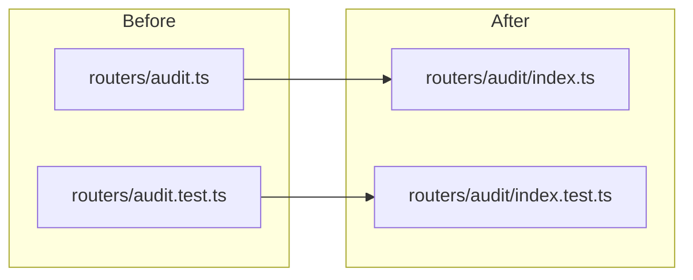

# Folder-per-module layout

Mechanical refactor only: `git mv`, rewrite imports, keep behavior identical. No logic changes.

## Conventions

- **Folders:** kebab-case (`audit/`, `contact-select/`), matching the rest of the repo.
- **Files inside each folder:** `index.ts` (or `.tsx`) + `index.test.ts` (or `.tsx`).
- **Imports after the move:**
  - API uses `module: nodenext` and explicit `.ts` extensions, so directory imports must be `../routers/audit/index.ts` (not `../routers/audit.ts`).
  - Web `@/` aliases keep working (`@/lib/currency` resolves to `lib/currency/index.ts`). Relative `./foo.ts` must become `./foo/index.ts` or `./foo`.
  - Tests live *inside* the folder, so they import the SUT from `./index.ts` (API) or `./index` (web).

## Out of scope (leave as-is)

- `[apps/web/src/routes/](apps/web/src/routes/)` — TanStack file routing; folders would change URLs.
- `[apps/web/src/components/ui/](apps/web/src/components/ui/)` — shadcn CLI expects flat files.
- `[packages/shared/](packages/shared/)`
- `[apps/web/src/data/](apps/web/src/data/)`, `[hooks/](apps/web/src/hooks/)`, `[i18n/](apps/web/src/i18n/)`
- API process entry `[apps/api/src/index.ts](apps/api/src/index.ts)` and test helpers `[apps/api/src/test/](apps/api/src/test/)`




---

## 1. API

### Routers

`[apps/api/src/routers/](apps/api/src/routers/)` — one folder per router:

- `audit`, `contacts`, `credentials`, `dashboard`, `invoices`, `projects`, `tools`

Hub update in `[apps/api/src/trpc/router.ts](apps/api/src/trpc/router.ts)`:

```ts
import { auditRouter } from "../routers/audit/index.ts"
// ...same for the other six
```

Cross-router imports (`listProjects` from projects, `sealNewSecret` from credentials) become `./projects/index.ts` and `./credentials/index.ts`.

### Rest of API


| Current                                                      | After                                                               |
| ------------------------------------------------------------ | ------------------------------------------------------------------- |
| `src/app.ts` + test                                          | `src/app/index.ts` + `index.test.ts`                                |
| `src/auth.ts` + test                                         | `src/auth/`                                                         |
| `src/env.ts` + test                                          | `src/env/`                                                          |
| `src/mount.ts` + test                                        | `src/mount/`                                                        |
| `src/server.ts` + test                                       | `src/server/`                                                       |
| `audit/diff.ts` + test                                       | `audit/diff/`                                                       |
| `audit/record.ts` + test                                     | `audit/record/`                                                     |
| `crypto/envelope.ts` + test                                  | `crypto/envelope/`                                                  |
| `db/client.ts` + test                                        | `db/client/`                                                        |
| `db/schema.ts` + test + `schema.auth.test.ts` + `schema.sql` | `db/schema/index.ts`, `index.test.ts`, `auth.test.ts`, `schema.sql` |
| `db/test-db.ts`, `db/with-user.ts`                           | `db/test-db/index.ts`, `db/with-user/index.ts`                      |
| `db/isolation.test.ts` (no source)                           | `db/isolation/index.test.ts`                                        |
| `trpc/init.ts` + test                                        | `trpc/init/`                                                        |
| `trpc/router.ts` + test                                      | `trpc/router/`                                                      |


Keep `src/index.ts` as the process entry (`import { start } from "./server/index.ts"`).

---

## 2. Web `lib/`

Every file in `[apps/web/src/lib/](apps/web/src/lib/)` becomes a folder, including modules without a 1:1 test today:

- With sibling tests: `audit-labels`, `audit-period`, `auth-client`, `auth-errors`, `currency`, `dates`, `format`, `pagination`, `project-schema`, `project-status`, `table-sort`, `trpc`, `utils`
- Source only, then split the aggregate tests into that folder: `projects-store`, `registry-store` (from `stores.test.tsx`), `use-debounced-value`, `use-draft-search` (from `hooks.test.ts`)

shadcn alias `"utils": "@/lib/utils"` in `[apps/web/components.json](apps/web/components.json)` still resolves.

---

## 3. Web feature components

Same pattern one level deeper inside the existing domain folders. Example:

`components/projects/contact-select.tsx` + `.test.tsx` → `components/projects/contact-select/index.tsx` + `index.test.tsx`

- `[components/dashboard/](apps/web/src/components/dashboard/)`: `cards`, `chart-parts`, `filters-bar`, `finance-tab`, `payment-ruler`, `tools-tab`
- `[components/kanban/](apps/web/src/components/kanban/)`: `kanban-board`, `kanban-card`, `kanban-column`, `project-issue-dialog`
- `[components/layout/](apps/web/src/components/layout/)`: `app-shell`, `page`, `sidebar-nav`, `user-menu`
- `[components/projects/](apps/web/src/components/projects/)`: `contact-select`, `create-project-dialog`, `invoices-table`, `status-badges`, `tool-details`, `tool-field`, `tool-icons`, `tool-select`
- `[components/settings/](apps/web/src/components/settings/)`: `contacts-panel`, `create-contact-dialog`, `create-custom-tool-dialog`, `custom-tools-panel`, `general-registry`

Sibling imports such as `from "./tool-select"` keep working (bundler resolves the folder `index`).

---

## 4. How to execute

1. `git mv` first (preserves history), then search-replace import paths.
2. Do API first, then web `lib`, then web components — run `pnpm --filter api test` / `pnpm --filter web test` after each slice.
3. No new barrels (`routers/index.ts`, `lib/index.ts`). Callers import the module folder (or `/index.ts` on the API).
4. Suggested commits (English semantic, one slice each):
  - `refactor(api): nest routers and modules into folders`
  - `refactor(ui): nest lib helpers into folders`
  - `refactor(ui): nest feature components into folders`

Vitest already includes `src/**/*.test.ts(x)`, so `index.test.ts` is picked up with no config change.