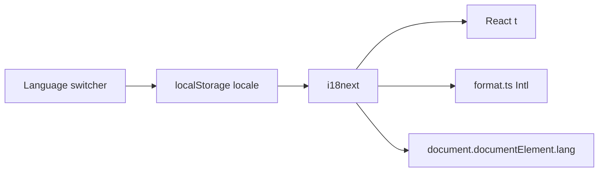

# Add en-US / pt-BR i18n

The app is Portuguese-first with **no i18n library**. About 400 user-facing strings are hardcoded in `apps/web`. The API is already English. Domain enums stay English (`queued`, `boleto`, `pix`); only labels change.

**Default:** `en-US` (language + date/number format). Switching to Portuguese also switches formatting to `pt-BR`. Pix, Boleto, BRL, and the BR phone mask stay.

## Stack

- Add `i18next` + `react-i18next` to [apps/web/package.json](apps/web/package.json).
- Use **i18next itself** (not only the React hook) so non-React modules that run under Node self-checks can call `i18n.t()`: [apps/web/src/lib/format.ts](apps/web/src/lib/format.ts), [apps/web/src/lib/audit-labels.ts](apps/web/src/lib/audit-labels.ts), [apps/web/src/lib/project-schema.ts](apps/web/src/lib/project-schema.ts).
- Catalogs:
  - [apps/web/src/i18n/en-US.json](apps/web/src/i18n/en-US.json) — new English copy
  - [apps/web/src/i18n/pt-BR.json](apps/web/src/i18n/pt-BR.json) — current strings, moved verbatim
  - [apps/web/src/i18n/index.ts](apps/web/src/i18n/index.ts) — init, `SUPPORTED_LOCALES`, persist, `document.documentElement.lang`
- Nested keys by area (`nav`, `status`, `auth`, `projects`, `dashboard`, `kanban`, `settings`, `audit`, `validation`, `common`).
- Init on import from [apps/web/src/main.tsx](apps/web/src/main.tsx). Wrap the tree with `I18nextProvider` in [apps/web/src/routes/__root.tsx](apps/web/src/routes/__root.tsx).
- Persist `locale` in `localStorage`. Default `en-US` when unset. No browser auto-detect (avoids surprising a user who asked for English-first).

## Language switcher

Add a language control in [apps/web/src/components/layout/user-menu.tsx](apps/web/src/components/layout/user-menu.tsx) (always reachable): **English** / **Português**. Changing it calls `i18n.changeLanguage`, updates `html lang`, and re-renders via `useTranslation()`.

Set [apps/web/index.html](apps/web/index.html) `lang` to `en-US` as the static default; runtime overwrites it.

## Locale-aware formatting (not copy-only)

Replace every hardcoded `"pt-BR"` with the active i18n language:

| Area                                       | File                                                                 | Change                                                                                                                                                                                                                                         |
| ------------------------------------------ | -------------------------------------------------------------------- | ---------------------------------------------------------------------------------------------------------------------------------------------------------------------------------------------------------------------------------------------- |
| Currency, %, compact, months               | [apps/web/src/lib/format.ts](apps/web/src/lib/format.ts)             | `Intl.NumberFormat` / `toLocaleDateString` keyed by locale **and** currency (cache both). `formatDate`: `en-US` → `MM/DD/YYYY`, `pt-BR` → `DD/MM/YYYY` (keep manual ISO split to avoid the UTC timezone bug). Deal/progress strings via `t()`. |
| Currency names                             | [apps/web/src/lib/currency.ts](apps/web/src/lib/currency.ts)         | `getCurrencyOptions()` using `Intl.DisplayNames([locale])` — do not compute once at module load.                                                                                                                                               |
| Audit timestamps                           | [apps/web/src/lib/audit-labels.ts](apps/web/src/lib/audit-labels.ts) | `toLocaleString(locale)` + translated action/field strings.                                                                                                                                                                                    |
| Table sort                                 | [apps/web/src/lib/table-sort.ts](apps/web/src/lib/table-sort.ts)     | `localeCompare(a, b, locale)`.                                                                                                                                                                                                                 |
| Month picker, invoice month, kanban counts | month-picker, invoices-table, kanban route                           | Same locale.                                                                                                                                                                                                                                   |

**Money parsing** in [packages/shared/src/money.ts](packages/shared/src/money.ts): add optional `locale`. `en-US` treats `.` as decimal and `,` as thousands (`18,000.50`); `pt-BR` keeps today’s `18.000,50`. Web schemas pass the current locale. Tests in [packages/shared/src/money.check.ts](packages/shared/src/money.check.ts) cover both.

**Unchanged product domain:** `DEFAULT_CURRENCY = "BRL"`, payment methods `boleto` / `pix`, `maskBrPhone`. Labels: “Pix” / “Boleto” in both catalogs (proper nouns).

## Label maps → `t()`

Replace static maps in [apps/web/src/data/projects.ts](apps/web/src/data/projects.ts) and [apps/web/src/data/tool-catalog.ts](apps/web/src/data/tool-catalog.ts) with thin helpers (or call `t()` at the call site):

- `PROJECT_STATUS_LABEL`, `DEAL_KIND_LABEL`, `FREE_LABEL`, `INVOICE_STATUS_LABEL`, `PAYMENT_METHOD_LABEL`, `BILLING_CYCLE_LABEL`, `PAYER_LABEL`, `WORKFLOW_STATUS_*`, `TOOL_CATEGORY_LABEL`

Callers: status badges, kanban columns, invoices table, create-project dialog, tools tab, audit formatter, etc.

**Dashboard “Outras” bucket:** [apps/web/src/lib/dashboard-metrics.ts](apps/web/src/lib/dashboard-metrics.ts) should keep returning `key: "other"` and stop embedding a Portuguese `label`. Translate in the chart UI. Update the assertion in [apps/web/src/lib/dashboard-metrics.check.ts](apps/web/src/lib/dashboard-metrics.check.ts) from `label === "Outras"` to `key === "other"`.

## UI copy extraction

Move every user-visible string in routes and components to catalogs. Highest-volume files:

- Routes: login, dashboard, kanban, projects index/detail, settings, audit, `__root`
- Dialogs: create-project, create-contact, create-custom-tool, project-issue, confirm-dialog (`confirmWord` becomes `t("common.deleteWord")` → `"delete"` / `"excluir"`)
- Dashboard, settings panels, layout (sidebar, user menu, app-shell)
- Shared primitives with defaults: select placeholder, table pagination, filter drawer, row-actions

**Zod:** do not bake messages at module load (they would stick after a language switch). Turn [apps/web/src/lib/project-schema.ts](apps/web/src/lib/project-schema.ts) and login `authSchema` into factories that call `i18n.t()` at parse time (or `superRefine` with `t()`). Checks already assert error **paths**, not message text.

## Out of scope for catalogs

- API (`apps/api`) — already English TRPC messages; map known codes on the client if shown in UI (login already does this).
- User/project **data** (names, comments, mock arrays in `data/projects.ts` — unused by the live API store).
- Code comments: translate the few Portuguese JSDocs to English (not i18n).
- [CLAUDE.md](CLAUDE.md): rewrite the product brief in English (docs, not a runtime catalog).

## Verification

- Run web/shared self-checks (`check:schema`, `check:dashboard`, `check:table-sort`, `money.check.ts`, etc.).
- In the browser: load default English; switch to Português; confirm nav, forms, toasts, dates (`MM/DD/YYYY` vs `DD/MM/YYYY`), currency (`$18,000.50` vs `R$ 18.000,50` depending on currency+locale), confirm-delete word, and that a reload keeps the chosen language.
- Spot-check login, projects, project detail, kanban, dashboard, settings, audit.

