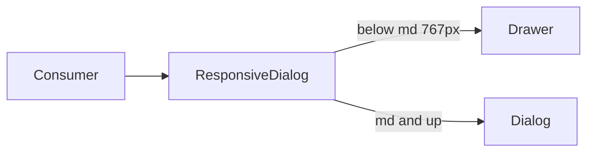

# Responsive dialog via composition

The app already has the right primitives — `[dialog.tsx](apps/web/src/components/ui/dialog.tsx)` (centered glass modal) and `[drawer.tsx](apps/web/src/components/ui/drawer.tsx)` (bottom sheet) — but the switch is copy-pasted in four files via `useIsMobile()`, and two modals never switch at all.

Build one compound component and use it for **every modal**. Keep raw `Drawer` only where the desktop UX is *not* a dialog (filter sheet, nav).




## Component API

New file: `[apps/web/src/components/ui/responsive-dialog.tsx](apps/web/src/components/ui/responsive-dialog.tsx)`

Compound parts (same shape as Dialog/Drawer, Base UI `render` prop — not Radix `asChild`):

- `ResponsiveDialog` — root; `open` / `onOpenChange`; context holds `isMobile`
- `ResponsiveDialogTrigger`
- `ResponsiveDialogContent` — `className` on both shells; `dialogClassName` / `drawerClassName` for one-sided sizing (`max-w-6xl`, `h-[90svh]`)
- `ResponsiveDialogHeader` / `Title` / `Description`
- `ResponsiveDialogBody` — the missing slot today: scrollable padded region (`p-4` drawer, `px-5 py-4` dialog)
- `ResponsiveDialogFooter` — desktop `justify-end` bar; mobile `flex-row [&>*]:flex-1` (current form convention)
- `ResponsiveDialogClose` — ghost X on desktop; renders nothing on mobile (swipe handle + Cancel)

Usage (one tree, no `if (isMobile)` in features):

```tsx
<ResponsiveDialog open={open} onOpenChange={onOpenChange}>
  <ResponsiveDialogContent dialogClassName="max-w-2xl">
    <ResponsiveDialogHeader>
      <div>
        <ResponsiveDialogTitle>{heading}</ResponsiveDialogTitle>
        <ResponsiveDialogDescription>{subheading}</ResponsiveDialogDescription>
      </div>
      <ResponsiveDialogClose />
    </ResponsiveDialogHeader>
    <form className="flex min-h-0 flex-1 flex-col">
      <ResponsiveDialogBody>{fields}</ResponsiveDialogBody>
      <ResponsiveDialogFooter>
        {cancelButton}
        {submitButton}
      </ResponsiveDialogFooter>
    </form>
  </ResponsiveDialogContent>
</ResponsiveDialog>
```

Implementation notes:

- **One tree, not two.** Context + pick Dialog vs Drawer. Do not mount both (duplicate titles / a11y).
- **Freeze mode while open.** Capture `useIsMobile()` when `open` becomes true so a mid-edit resize does not remount and wipe form state.
- **Mobile drawer defaults:** `showSwipeHandle`, swipe `down`, max height `~90dvh` (matches create-project).
- **Title required** (shadcn rule). `Description` may be `sr-only`.
- Leave `[dialog.tsx](apps/web/src/components/ui/dialog.tsx)` / `[drawer.tsx](apps/web/src/components/ui/drawer.tsx)` as primitives. Feature code should not import them for modals.

Do **not** add this from the shadcn registry — it is not a stock component, and this project is Base UI (`base-luma`), not Radix/Vaul.

## Migrate every modal

Rewrite shells only; keep form/data logic.


| File                                                                                              | Change                                                           |
| ------------------------------------------------------------------------------------------------- | ---------------------------------------------------------------- |
| `[confirm-dialog.tsx](apps/web/src/components/ui/confirm-dialog.tsx)`                             | Internal rewrite; public API unchanged                           |
| `[create-project-dialog.tsx](apps/web/src/components/projects/create-project-dialog.tsx)`         | Drop duplicated Drawer/Dialog trees                              |
| `[create-contact-dialog.tsx](apps/web/src/components/settings/create-contact-dialog.tsx)`         | Same                                                             |
| `[create-custom-tool-dialog.tsx](apps/web/src/components/settings/create-custom-tool-dialog.tsx)` | Same                                                             |
| `[project-issue-dialog.tsx](apps/web/src/components/kanban/project-issue-dialog.tsx)`             | First mobile drawer; `dialogClassName` for `max-w-6xl h-[90svh]` |
| `[audit.tsx](apps/web/src/routes/audit.tsx)`                                                      | First mobile drawer for event detail                             |


Leave as Drawer-only (not modals):

- `[filter-drawer.tsx](apps/web/src/components/ui/filter-drawer.tsx)` — desktop already has inline filters
- `[app-shell.tsx](apps/web/src/components/layout/app-shell.tsx)` — mobile nav (`swipeDirection="left"`)

## Visual unification

All modals share one chrome:

- Header with border-b; desktop X via `ResponsiveDialogClose`
- Body scrolls; footer stays put
- Glass styles stay on the primitives (no extra z-index)

Confirm dialog will pick up Header/Body/Footer instead of a single `p-5` panel — same tokens, slightly more consistent.

## Verify

Browser, desktop and a viewport below 768px:

- Create/edit project, contact, custom tool (submit + cancel + swipe dismiss)
- Delete confirm (with and without `confirmWord`)
- Kanban project issue (scroll, close, “Acessar projeto”)
- Audit event detail
- Filter drawer and mobile nav still Drawer-only (no accidental dialog)

