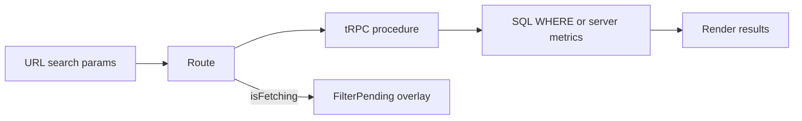

# Server-side filters

Projects, Kanban, Dashboard, and invoices still filter in the browser (`useState` + `.filter()` on a full payload). Audit already filters in SQL via `audit.list`, but its controls are `useState` with no URL params and no FilterPending. No list page syncs filters to the URL today. Loading is a full-page “Carregando…” (audit uses the table empty message).

Out of scope: DataTable sort/pagination on Projects / invoices / dashboard tool rows stays in memory on the **already-filtered** page result. **Audit is the exception** — it already keyset-paginates and sorts on the server; keep that. Settings contacts/tools have no filters.

## Current inventory

Client-side today (must move):

- **Projects** ([`apps/web/src/routes/projects.index.tsx`](apps/web/src/routes/projects.index.tsx)): `q` (name or client), `status`, `workflow`
- **Kanban** ([`apps/web/src/routes/kanban.tsx`](apps/web/src/routes/kanban.tsx) + [`apps/web/src/lib/kanban-filter.ts`](apps/web/src/lib/kanban-filter.ts)): `q`, `client`, `from`/`to` on `startedAt`
- **Dashboard** ([`apps/web/src/routes/dashboard.tsx`](apps/web/src/routes/dashboard.tsx)): period, client, project, currency — `applyFilters` + `financeSummary` / chart helpers in the browser
- **Invoices** ([`apps/web/src/components/projects/invoices-table.tsx`](apps/web/src/components/projects/invoices-table.tsx)): status + month range on **mock** invoices from [`generateInvoices`](apps/web/src/lib/invoices.ts) (DB `invoices.list` is unused by the UI)

Already SQL, missing URL + FilterPending:

- **Audit** ([`apps/web/src/routes/audit.tsx`](apps/web/src/routes/audit.tsx) + [`apps/api/src/routers/audit.ts`](apps/api/src/routers/audit.ts)): search, module, period (`today`/`7d`/`30d`/`90d`/`all`/`custom`) already go to `audit.list` as `search` / `modules` / `from` / `to`. Filters live in `useState`, not the URL. Loading is the table empty message “Carregando…”. Period presets expand to `from`/`to` in [`periodBounds`](apps/web/src/lib/audit-period.ts) on the client before the query — that stays; matching remains SQL.

## 1. Shared filter schemas

Add Zod schemas in `[packages/shared](packages/shared/src)` so the API input and TanStack Router `validateSearch` share one source:

- `projectListFiltersSchema` — `q`, `status`, `workflow`, `clientId`, `monthFrom`, `monthTo` (all optional)
- `dashboardFiltersSchema` — `monthFrom`, `monthTo`, `projectId`, `clientId`, `currency`
- `invoiceListFiltersSchema` — `projectId`, `status` (`all` | pending/paid/overdue), `monthFrom`, `monthTo`
- `auditSearchSchema` (URL) — `q`, `module`, `period` (default `30d`), `from`/`to` when `period=custom`. Reuse existing `audit.list` input on the API ([`listInput`](apps/api/src/routers/audit.ts)); do not add a second audit list procedure.

Empty strings are omitted from the URL (`replace: true` so filter tweaks do not spam history). Text search (`q`) is local while typing and written to the URL after ~300ms debounce (audit already has [`useDebouncedValue`](apps/web/src/lib/use-debounced-value.ts); reuse it).

## 2. Move computation to a place the API can run

The API cannot import `apps/web`. Move the existing **pure** modules into `packages/shared` (keep the self-checks next to them):

- `[dashboard-metrics.ts](apps/web/src/lib/dashboard-metrics.ts)`
- `[invoices.ts](apps/web/src/lib/invoices.ts)` (`generateInvoices` mock — still the source of invoice rows until persistence is wired)
- `[invoice-table.ts](apps/web/src/lib/invoice-table.ts)`
- date helpers those files need from `[dates.ts](apps/web/src/lib/dates.ts)`

Web UI then **only renders** DTOs. It does not call `applyFilters`, `matchesKanbanFilter`, `filterInvoices`, or `financeSummary`.

## 3. API procedures

`**[projects.list](apps/api/src/routers/projects.ts)**` — optional filter input. SQL `WHERE` (user isolation already via `asUser`):

- `q`: `ilike` on `project.name` **or** joined `contact.name`
- `status`: `eq(project.status)`
- `workflow`: `eq(project.repoWorkflow)`
- `clientId`: `eq(project.contactId)`
- `monthFrom` / `monthTo`: bound `project.startedAt` to the month (`YYYY-MM-01` … last day)

No-input call stays as today so `[ProjectsProvider](apps/web/src/lib/projects-store.tsx)` can keep the unfiltered cache for mutations, project detail, and “contact in use” checks.

`**dashboard.metrics**` (new router, registered in `[apps/api/src/trpc/router.ts](apps/api/src/trpc/router.ts)`) — load the user’s projects once, then on the **server**:

- `options` from the unfiltered set (clients with projects, projects with `clientId`, currencies) so dropdowns do not collapse when a filter is active
- `applyFilters` + `resolveMonths` + `financeSummary` / `previousMonths` + finance series + tools series + payment-ruler lanes

Return a DTO the current tabs already need (summary, `foraDaMoeda`, `revenueByMonth`, `profitByProject`, `clientGrowth`, ruler lanes, `toolsSummary`, `toolCostByTool` / `ByCategory` / `ByMonth`, `toolRows`). `[FinanceTab](apps/web/src/components/dashboard/finance-tab.tsx)`, `[ToolsTab](apps/web/src/components/dashboard/tools-tab.tsx)`, and `[PaymentRuler](apps/web/src/components/dashboard/payment-ruler.tsx)` become render-only.

`**[invoices.list](apps/api/src/routers/invoices.ts)**` — `projectId` required for the project page; generate via shared `generateInvoices` (same mock as today), then `filterInvoices`. Used by project detail and the kanban issue dialog (no more `generateInvoices` in the browser).

Invalidate `["projects"]`, `["dashboard"]`, `["invoices"]`, and `["audit"]` after mutations (audit invalidation is already in the stores).

**Audit:** no new SQL. Keep [`listAuditLogs`](apps/api/src/routers/audit.ts). The page work is URL + FilterPending only. Keyset cursor, `pageSize`, and `serverSort` stay in component state (not the URL) so a shared filter link does not carry a stale cursor.

## 4. URL as the filter state

Each filtered route uses TanStack Router `validateSearch` (zod) + `Route.useSearch()` / `navigate({ search, replace: true })`:

- `/projects` — `q`, `status`, `workflow`
- `/kanban` — `q`, `client`, `from`, `to`
- `/dashboard` — `from`, `to`, `client`, `project`, `currency`
- `/projects/$projectId` — `status`, `from`, `to` (invoice table)
- `/audit` — `q`, `module`, `period`, and `from`/`to` when custom. Drive `trpc.audit.list` from search (same as today, minus `useState` for those fields). Reset the cursor stack when URL filters change (current `filterKey` pattern).

Pages that show a filtered list use `useQuery({ queryKey: […, search], queryFn: () => trpc.…query(search), placeholderData: keepPreviousData })` — **not** `useProjects().projects.filter(...)`. Audit already uses this query pattern.

`[KanbanBoard](apps/web/src/components/kanban/kanban-board.tsx)`: drop the `filter` callback; take `projects` from the filtered query. On drag-end, call existing `move` for the dragged card only — do **not** `replaceProjects` with the filtered subset (that would wipe hidden projects from the store cache).

## 5. Loading treatment

Replace the generic centered “Carregando…” **for filter refetches** (keep the auth/workspace gate as-is).

New `FilterPending` around the results (filters stay interactive):

- First load (`isPending`): skeleton in the same layout (table rows including audit, kanban columns, dashboard stat tiles)
- Refetch (`isFetching` with previous data): results stay, go muted (`opacity` + `aria-busy`), hairline **bordô scan** under the filter bar (brand `--primary`, the “ledger is being recast” beat). `[useReducedMotion](apps/web/src/hooks/use-reduced-motion.ts)`: no traveling line, static muted state only

## 6. Rule

Add `[.cursor/rules/server-side-filters.mdc](.cursor/rules/server-side-filters.mdc)` (`alwaysApply: true`):

- Filters live in URL search params and are sent to tRPC
- Matching is SQL or server procedures, never `array.filter` on fetched collections
- Loading uses `FilterPending`, not a blank page
- Dropdown option lists come from an unfiltered options payload so a selected filter cannot hide its own controls

## 7. Checks

- API self-check: SQL list filters (search on client name, status, workflow, month bounds)
- Keep dashboard / invoice-table checks, now running from `packages/shared`
- Replace [`kanban-filter.check.ts`](apps/web/src/lib/kanban-filter.check.ts) with the API list-filter check (delete the client matcher once unused)
- Audit SQL coverage already lives in [`apps/api/src/routers/audit.check.ts`](apps/api/src/routers/audit.check.ts); no new audit SQL tests unless URL parsing of `period`/`from`/`to` needs a small `periodBounds` check (already exists as a helper)

