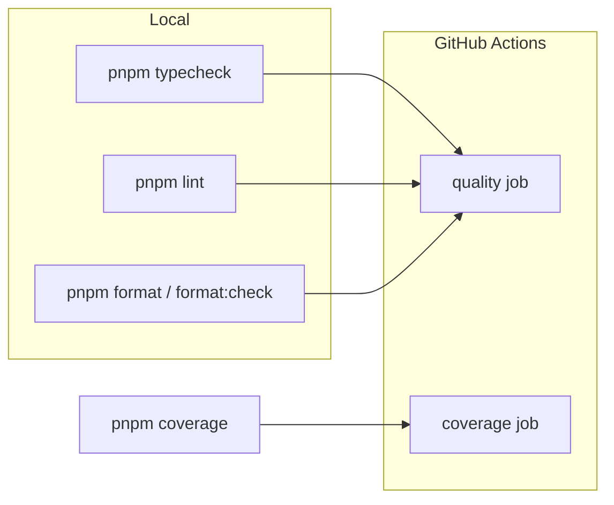

# Typecheck, ESLint, Prettier, and CI

Existing baseline: pnpm workspace (`web`, `api`, `shared`). CI (`[.github/workflows/test.yml](.github/workflows/test.yml)`) only runs `pnpm coverage`. ESLint exists only on web (`[apps/web/eslint.config.js](apps/web/eslint.config.js)`). `api` and `shared` currently set `"lint": "pnpm test"`. Prettier is not configured. Web typechecks only as part of `build` (`tsc -b && vite build`); api/shared have `tsconfig.json` but no `typescript` dependency and no `typecheck` script.

## Tooling layout

Keep **Prettier at the root** (one style for the whole repo). Keep **ESLint and Typecheck per package** so web can stay on React/Vite plugins while api/shared stay Node-only.

**Prettier options** (match current code as closely as possible): `semi: false` (already true everywhere), `singleQuote: true` (Vite/web majority; api/shared switch from double quotes), `printWidth: 100` (avoids wrapping long Tailwind `className`s at 80). No `eslint-plugin-prettier` — Prettier stays a separate check. Add `eslint-config-prettier` so ESLint does not fight formatting.

Out of scope: husky/lint-staged, type-aware ESLint (`recommendedTypeChecked`), enabling `strict` on web, Tailwind class sorting, deploy/CD (Railway already deploys the API).

## Root scripts and Prettier

Update `[package.json](package.json)`:

- `typecheck`: `pnpm -r typecheck`
- `lint`: keep `pnpm -r lint` (will become real ESLint everywhere)
- `format`: `prettier --write .`
- `format:check`: `prettier --check .`

Add `prettier` and `eslint-config-prettier` at the root (prettier is only needed once). Create:

- `[.prettierrc.json](.prettierrc.json)` with the options above
- `[.prettierignore](.prettierignore)`: `node_modules`, `dist`, `coverage`, `pnpm-lock.yaml`, `**/routeTree.gen.ts`, `**/.tanstack/`

## Typecheck

| Package | Script                        | Notes                                   |
| ------- | ----------------------------- | --------------------------------------- |
| web     | `"typecheck": "tsc -b"`       | Same compiler as `build`, without Vite  |
| api     | `"typecheck": "tsc --noEmit"` | Add `typescript` `~6.0.2` (same as web) |
| shared  | `"typecheck": "tsc --noEmit"` | Same                                    |

Do **not** turn on `strict` for web in this change (`[apps/web/tsconfig.app.json](apps/web/tsconfig.app.json)` currently omits it). Leave api/shared `build: pnpm test` as-is.

## ESLint

**web:** keep `[apps/web/eslint.config.js](apps/web/eslint.config.js)`; append `eslint-config-prettier` last in `extends` so formatting rules are disabled.

**api / shared:** add a small flat `eslint.config.js` each (Node globals, `js.recommended` + `typescript-eslint` recommended, ignore `dist`/`coverage`/`**/*.test.ts`). Replace `"lint": "pnpm test"` with `"lint": "eslint ."`. Declare `eslint`, `@eslint/js`, `typescript-eslint`, `globals`, and `eslint-config-prettier` in those packages (pnpm will not hoist them for `eslint.config.js` imports otherwise).

## CI

Replace `[.github/workflows/test.yml](.github/workflows/test.yml)` with `[.github/workflows/ci.yml](.github/workflows/ci.yml)` (`name: ci`), same triggers (`push` + `pull_request`), Node 22 / pnpm 10 / frozen lockfile.

Two parallel jobs sharing the same setup:

- **quality** — `pnpm typecheck`, `pnpm lint`, `pnpm format:check` as separate steps (clear failure in the GitHub UI)
- **coverage** — existing `pnpm coverage` (20m timeout)

## Make CI green

After wiring scripts, run typecheck/lint/format locally and:

1. Apply Prettier across the repo (expected large style diff, especially quote style in api/shared).
2. Fix any existing `tsc` or ESLint errors this newly surfaces in api/shared (web already lints today).

No new Vitest files: this is tooling, not app behavior. Existing tests must still pass after the format pass (`pnpm coverage`).

## Pre-delivery Cursor rule

Add [`.cursor/rules/pre-delivery.mdc`](.cursor/rules/pre-delivery.mdc) (`alwaysApply: true`), same shape as the other workspace rules (YAML frontmatter, under ~50 lines, concrete ❌/✅ examples).

The rule must tell the agent **not to declare work done or return a completion answer** until all four gates pass locally — the same gates CI will run:

1. `pnpm typecheck`
2. `pnpm lint`
3. `pnpm format:check`
4. `pnpm test` (or `pnpm coverage` when the change can affect coverage thresholds)

If any command fails: fix, re-run the failing gate (and the others if the fix could affect them), then answer. Do not finish with “CI will catch it”, “format later”, or “tests later”.

**Out of scope for the gate** (no need to run the four commands): questions, plan-only discussion, and changes that cannot affect TS/lint/format/tests (for example copy-only catalog edits still run `check:i18n` per the existing i18n rule; this rule does not replace [`.cursor/rules/test-coverage.mdc`](.cursor/rules/test-coverage.mdc)).